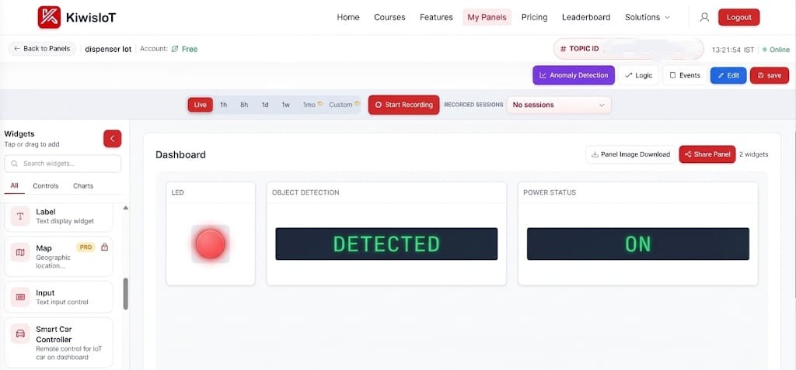

# 💧 Smart Automatic Water Dispenser and Monitoring System

## 📌 Project Overview

This project demonstrates an automatic water dispensing system using NodeMCU ESP8266, an IR sensor, a relay module and a DC water pump.

The IR sensor detects the presence of an object. Once an object is detected, NodeMCU activates the relay, which switches ON the water pump. An LED indicates the dispensing operation. The dispenser activation status is also sent to the KiwisIoT platform for remote monitoring.

## 🎯 Objectives

- Develop an automatic water dispensing system.
- Detect objects using an IR sensor.
- Control a water pump using a relay module.
- Monitor dispenser activation status remotely.
- Understand sensor-based automation.

## 🛠️ Components Required

- NodeMCU ESP8266
- IR Sensor
- 1-Channel Relay Module
- DC Water Pump
- LED
- 220Ω Resistor
- Breadboard
- Jumper Wires
- External Power Supply for the Pump

## 💻 Software Required

- Arduino IDE
- ESP8266 Board Package
- KiwisIoT Platform
- KiwisIoT Library

[View Arduino Code](./dispenser.ino)

## 🔌 Pin Connections

| Component | NodeMCU Pin |
|---|---|
| IR Sensor OUT | D1 |
| Relay IN | D2 |
| LED | D5 |
| IR Sensor VCC | 3.3V |
| IR Sensor GND | GND |

## ⚙️ Working Principle

1. The IR sensor continuously detects the presence of an object.
2. When an object is detected, it sends a signal to NodeMCU.
3. NodeMCU activates the relay module.
4. The relay switches ON the water pump.
5. The LED glows to indicate that the dispenser is active.
6. The activation status is sent to the KiwisIoT dashboard.
7. After the predefined dispensing time, the pump and LED turn OFF.
8. The dashboard receives the updated OFF status.

## 📊 KiwisIoT Dashboard

| Channel | Description |
|---|---|
| Channel 0 | Dispenser Status (1 = ON, 0 = OFF) |

## ✨ Features

- Automatic object detection.
- Contactless water dispensing.
- Relay-controlled pump operation.
- LED-based dispensing indication.
- Remote status monitoring through KiwisIoT.
- Time-controlled dispensing operation.

## 📚 Applications

- Automatic water dispensers.
- Contactless liquid dispensing systems.
- Smart water distribution systems.
- Automated liquid dispensing applications.

## 🚀 Future Enhancements

- Water-level monitoring.
- Adjustable dispensing duration.
- Mobile notifications.
- Water usage measurement.
- Multiple dispensing modes.

## 📖 Learning Outcomes

- Understanding IR sensor interfacing.
- Learning relay-based pump control.
- Interfacing output devices with NodeMCU.
- Understanding automated dispensing systems.
- Sending sensor and device status to an IoT platform.

## 👨‍💻 Developed Using

NodeMCU ESP8266 | IR Sensor | Relay Module | DC Water Pump | LED | Arduino IDE | KiwisIoT

IoT Platform:*[KiwisIoT](https://kiwisiot.in)

---

